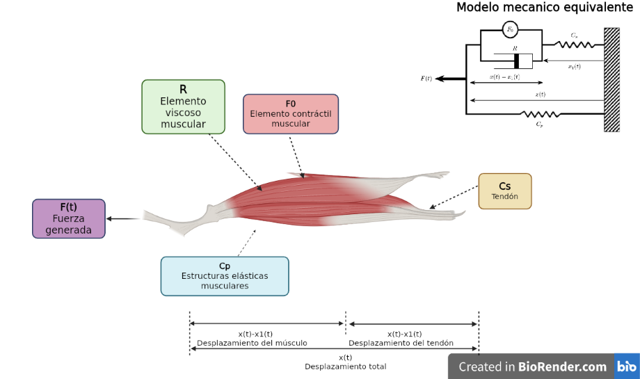

# Práctica 3 — Modelado y control del sistema musculoesquelético

**Tecnológico Nacional de México · Instituto Tecnológico de Tijuana**  
**Departamento:** Ingeniería Eléctrica y Electrónica  
**Carrera:** Ingeniería Biomédica  
**Asignatura:** Modelado de Sistemas Fisiológicos (IBF-1020)

| Información | Datos |
|---|---|
| **Estudiante** | Castro Alcántar Daniel Hiram |
| **Número de control** | 23212184 |
| **Correo institucional** | l23212184@tectijuana.edu.mx |
| **Docente** | Dr. Paul Antonio Valle Trujillo |
| **Modalidad** | Trabajo individual |
| **Fecha** | Noviembre de 2026 |

> **Resumen.** Se modela un sistema musculoesquelético simplificado formado por un elemento contráctil, un amortiguador y dos componentes elásticos. Mediante la analogía fuerza–voltaje se obtiene la **función de transferencia entre el desplazamiento y la fuerza, Gₓ(s) = X(s)/F(s)**, solicitada en la sección 5.5 del syllabus. Se estudian dos condiciones: individuo sano (*control*) y atrofia muscular simulada (*caso*). También se documenta la relación de transferencia normalizada implementada en Python, el análisis de estabilidad y la simulación de un sistema con control PI.

**Palabras clave:** Sistema musculoesquelético; Modelo matemático; Analogía electromecánica; Función de transferencia; Control PI; Simulaciones numéricas.

---

## 1. Descripción de la asignatura

Modelado de Sistemas Fisiológicos integra herramientas de Ingeniería de Control, Electrónica, Matemáticas y Programación para describir la dinámica de sistemas biológicos. Una parte central de la asignatura consiste en establecer analogías entre sistemas fisiológicos y sistemas físicos equivalentes, obtener ecuaciones diferenciales y funciones de transferencia, y comparar resultados mediante experimentación *in silico*.

Esta práctica se basa en la **sección 5.5, páginas 87–95, del syllabus de 2026**, elaborado por el Dr. Paul Antonio Valle Trujillo.

## 2. Objetivos

**Objetivo general.** Modelar el comportamiento dinámico de un sistema musculoesquelético mediante su representación mecánica y eléctrica equivalente, analizar las diferencias entre el control y el caso, y evaluar una estrategia de retroalimentación.

**Objetivos específicos:**

1. Identificar los elementos contráctiles, viscosos y elásticos del modelo.
2. Construir la analogía fuerza–voltaje e interpretar su circuito equivalente.
3. Formular las ecuaciones del sistema y **obtener explícitamente la función de transferencia X(s)/F(s)**.
4. Calcular las transferencias correspondientes al individuo sano y al caso simulado.
5. Analizar la estabilidad, los polos, la constante de tiempo y el comportamiento estacionario.
6. Representar y comparar las respuestas mediante MATLAB, Simulink y Python.
7. Describir el sistema de control PI utilizado para la simulación del caso.
8. Organizar los archivos, las gráficas y el diagrama biológico en GitHub.

## 3. Descripción del modelo musculoesquelético

El sistema representa una unidad musculotendinosa mediante un elemento contráctil activo, un amortiguador viscoso y dos componentes elásticos. El desplazamiento total se representa por **x(t)**, mientras que **x₁(t)** representa la deformación del elemento elástico en serie.

[](Biorender.png)

*Figura 1. Diagrama elaborado en BioRender. Se identifican la fuerza, el elemento contráctil, las estructuras elásticas musculares, la viscosidad y el tendón. Haz clic en la imagen para abrir el archivo original.*

| Símbolo | Elemento | Interpretación |
|---|---|---|
| **F(t)** | Fuerza aplicada al sistema | Entrada del modelo |
| **F₀(t)** | Elemento contráctil activo | Fuerza generada por la contracción muscular |
| **R** | Amortiguador viscoso | Oposición al movimiento relativo |
| **Cₚ** | Compliancia paralela | Propiedades elásticas musculares pasivas |
| **Cₛ** | Compliancia en serie | Elasticidad asociada al tendón |
| **x(t)** | Desplazamiento total | Variable de salida solicitada en el syllabus |
| **x₁(t)** | Desplazamiento en serie | Deformación del elemento Cₛ |

El syllabus establece la relación **F₀(t) = α · F(t)**, con **0 < α < 1**. El amortiguador experimenta la deformación **x(t) − x₁(t)** y su velocidad relativa es **d[x(t) − x₁(t)]/dt**.

### 3.1. Analogía electromecánica

Se utiliza la analogía **fuerza–voltaje** que propone el profesor:

| Sistema mecánico | Sistema eléctrico equivalente |
|---|---|
| Fuerza, F(t) | Voltaje, V(t) |
| Velocidad, dx(t)/dt | Corriente, I(t) |
| Desplazamiento, x(t) | Carga eléctrica, q(t) |
| Amortiguador viscoso | Resistencia, R |
| Compliancia mecánica | Capacitancia, C |
| Masa (si está presente) | Inductancia, L |

**Consideración:** la conversión no conserva necesariamente las conexiones mecánicas en serie y en paralelo. Deben respetarse las restricciones de desplazamiento y equilibrio de fuerzas antes de construir el circuito eléctrico equivalente.

### 3.2. Parámetros de la práctica

Los siguientes valores son los especificados en la **sección 5.5.2 del syllabus**, en unidades del circuito eléctrico equivalente:

| Parámetro | Individuo sano (control) | Atrofia simulada (caso) |
|---|---:|---:|
| Entrada F(t) | 1 V | 1 V |
| Coeficiente α | 0.25 | 0.25 |
| Cₛ | 10 µF | 10 µF |
| Cₚ | 100 µF | 100 µF |
| R | 100 Ω | 10 kΩ |

El único parámetro que cambia entre ambos escenarios es **R**, cuyo valor aumenta 100 veces para representar una modificación de la componente viscosa del modelo.

---

## 4. Desarrollo matemático y función de transferencia

Esta sección presenta la **función de transferencia de desplazamiento**, tal como la solicita el profesor, y después explica su relación con la función que aparece en el código Python.

**[Abrir el análisis matemático manuscrito (PDF)](Ana%CC%81lisismatematico.pdf)**

### 4.1. Ecuaciones del modelo

Al considerar el equilibrio de fuerzas y la deformación de cada elemento, se establecen las siguientes relaciones:

**Equilibrio de fuerzas:**

> **F(t) = x(t)/Cₚ + x₁(t)/Cₛ**

**Rama contráctil–viscosa y elemento en serie:**

> **x₁(t)/Cₛ = F₀(t) + R · d[x(t) − x₁(t)]/dt**

**Fuerza contráctil:**

> **F₀(t) = α · F(t)**

Al aplicar la transformada de Laplace con condiciones iniciales nulas:

- **F(s) = X(s)/Cₚ + X₁(s)/Cₛ**
- **X₁(s)/Cₛ = α · F(s) + R · s · [X(s) − X₁(s)]**

Despejando X₁(s) y sustituyendo en el equilibrio de fuerzas, se obtiene:

> **[R · (Cₚ + Cₛ) · s + 1] · X(s) = Cₚ · [R · Cₛ · s + (1 − α)] · F(s)**

### 4.2. FUNCIÓN DE TRANSFERENCIA PRINCIPAL: DESPLAZAMIENTO / FUERZA

La **función de transferencia solicitada por el syllabus** es la relación entre el desplazamiento total y la fuerza aplicada:

> **Gₓ(s) = X(s) / F(s)**
>
> **Gₓ(s) = Cₚ · [R · Cₛ · s + (1 − α)] / [R · (Cₚ + Cₛ) · s + 1]**

Esta es una **función de transferencia de primer orden**. El numerador considera el comportamiento del elemento elástico en serie y la contribución contráctil; el denominador reúne las compliancias y la amortiguación viscosa.

### 4.3. Funciones de transferencia del control y del caso

Al sustituir los valores numéricos de la tabla anterior:

**A. Individuo sano (control): R = 100 Ω**

> **Gₓ,control(s) = X_control(s) / F(s)**
>
> **Gₓ,control(s) = (0.0000001 · s + 0.000075) / (0.011 · s + 1)**

**B. Atrofia muscular simulada (caso): R = 10 000 Ω**

> **Gₓ,caso(s) = X_caso(s) / F(s)**
>
> **Gₓ,caso(s) = (0.00001 · s + 0.000075) / (1.1 · s + 1)**

**Interpretación:** la variación de R modifica el coeficiente que acompaña a **s** en numerador y denominador. El valor estacionario de la transferencia de desplazamiento permanece igual, pero el comportamiento transitorio cambia.

### 4.4. Funciones normalizadas utilizadas en Python

El archivo [`modeladopython.py`](modeladopython.py) implementa estas dos funciones:

**Control:**

> **G_normalizada,control(s) = (0.001 · s + 0.75) / (0.011 · s + 1)**

**Caso:**

> **G_normalizada,caso(s) = (0.1 · s + 0.75) / (1.1 · s + 1)**

**Relación con la transferencia principal:**

> **G_normalizada(s) = Gₓ(s) / Cₚ = X(s) / [Cₚ · F(s)]**

Por tanto, **X(s)/F(s) = Cₚ · G_normalizada(s)**. Así se explica por qué las expresiones del programa Python no contienen el factor Cₚ en el numerador. En el código se grafican señales identificadas como **Fs(t)**; no deben confundirse automáticamente con una gráfica directa del desplazamiento físico **x(t)**.

### 4.5. Ecuación diferencial equivalente

La función de transferencia principal corresponde, en el dominio del tiempo, a:

> **R · (Cₚ + Cₛ) · dx(t)/dt + x(t) = Cₚ · R · Cₛ · dF(t)/dt + Cₚ · (1 − α) · F(t)**

Esta expresión permite representar el sistema mediante integradores, ganancias y sumadores en Simulink, considerando el tratamiento apropiado del término derivativo de la entrada.

---

## 5. Análisis de estabilidad y error

### 5.1. Polos, ceros y constantes de tiempo

El polo de cada transferencia se obtiene anulando el denominador:

> **p = −1 / [R · (Cₚ + Cₛ)]**
>
> **τ = R · (Cₚ + Cₛ)**

| Propiedad | Control | Caso |
|---|---:|---:|
| Constante de tiempo, τ | 0.011 s | 1.1 s |
| Polo | −90.9091 s⁻¹ | −0.9091 s⁻¹ |
| Cero | −750 s⁻¹ | −7.5 s⁻¹ |
| Estabilidad | Estable | Estable |
| Ganancia estática X/F | 0.000075 | 0.000075 |

Los dos polos se encuentran en el **semiplano izquierdo**; por ello, ambos sistemas son estables. El caso simulado posee una constante de tiempo **100 veces mayor**, por lo que su respuesta dinámica es más lenta.

### 5.2. Estado estacionario

Para una fuerza de entrada representada por un escalón unitario y condiciones iniciales nulas, la ganancia estática de desplazamiento es:

> **Gₓ(0) = Cₚ · (1 − α) = 0.000075**

En las unidades del circuito eléctrico equivalente, una entrada de 1 V produciría una carga final equivalente de **75 µC**. Este valor **no debe interpretarse directamente como 75 µm de desplazamiento muscular**, porque los parámetros de la tabla son eléctricos.

Como ambos escenarios tienen la misma ganancia estática, la diferencia final entre sus respuestas de referencia al escalón es:

> **e_ss = x_control(∞) − x_caso(∞) = 0**

Esto no significa que las respuestas coincidan durante el transitorio: la diferencia más importante aparece en la rapidez de evolución. El error entre una entrada de fuerza y una salida de desplazamiento no debe calcularse restándolos directamente sin tener en cuenta sus unidades.

---

## 6. Simulación y control

### 6.1. Herramientas empleadas

| Herramienta | Propósito |
|---|---|
| **MATLAB Live Script** | Ejecutar y documentar los cálculos y resultados |
| **Simulink** | Representar el sistema mediante bloques y comparar respuestas |
| **Simscape Electrical** | Construir y analizar el circuito eléctrico equivalente, según el procedimiento del syllabus |
| **Python** | Simular funciones de transferencia con `numpy`, `control` y `matplotlib` |
| **BioRender** | Representar los elementos musculares y tendinosos del modelo |

### 6.2. Señal de entrada y resultados en Python

En [`modeladopython.py`](modeladopython.py) se define un intervalo de simulación **0–10 s**, con paso de **0.001 s**. La excitación utilizada es un **pulso rectangular de amplitud 1 entre t = 1 s y t = 2 s**.

El syllabus solicita evaluar la respuesta al **impulso unitario**. El pulso rectangular que aparece en el archivo es una excitación de duración finita, no un impulso de Dirac ideal; por ello, la comparación debe identificar correctamente la señal empleada.

El script permite comparar cuatro curvas: **entrada F(t)**, **control**, **caso** y **salida compensada**. La respuesta del caso cambia más lentamente que la del control, conforme al aumento de su constante de tiempo.

**Resultados disponibles en el repositorio:**

| Evidencia | Abrir archivo |
|---|---|
| Gráfica exportada de Python | [Musculoesqueletico_python.pdf](Im%C3%A1genes%20python,matlab/Musculoesqueletico_python.pdf) |
| Gráfica de MATLAB | [_matlab.pdf](Im%C3%A1genes%20python,matlab/_matlab.pdf) |
| Resultado del modelo de ecuaciones | [_matlabEDOsys.pdf](Im%C3%A1genes%20python,matlab/_matlabEDOsys.pdf) |
| Resultado MATLAB/Simulink | [_matlabsimulink.pdf](Im%C3%A1genes%20python,matlab/_matlabsimulink.pdf) |

*Las gráficas se encuentran en formato PDF. En GitHub se consultan desde los enlaces anteriores; no se incrustan como imágenes PNG.*

### 6.3. Estrategia de control PI

El objetivo de la retroalimentación es reducir la diferencia entre la respuesta del caso y la respuesta del individuo sano. En el código Python se utiliza un controlador **proporcional–integral (PI)**, es decir, sin término derivativo:

> **K_PI(s) = Kₚ + Kᵢ / s**

La estructura de retroalimentación unitaria se expresa mediante:

> **T(s) = [K_PI(s) · G_caso(s)] / [1 + K_PI(s) · G_caso(s)]**

En la implementación de Python, la respuesta del modelo sano se usa como **señal de referencia** para el modelo compensado. La interpretación del controlador debe hacerse respecto a la variable que realmente se introduce en cada modelo: **desplazamiento X(s)** en el planteamiento del syllabus o **salida normalizada** en el script suministrado.

No se presentan ganancias de nuevas capturas de PID Tuner como si fueran valores definitivos de los modelos.

### 6.4. Comparación entre implementaciones

Los archivos disponibles documentan simulaciones en MATLAB/Simulink y Python. La coincidencia cuantitativa requiere comprobar que se utilicen la **misma variable de salida, los mismos parámetros, las mismas condiciones iniciales y la misma señal de entrada**. En particular, comparar directamente X(s)/F(s) con la transferencia normalizada de Python sin aplicar el factor Cₚ produciría una diferencia de escala.

---

## 7. Archivos del repositorio

Los nombres siguientes corresponden a los archivos **que están actualmente publicados** en este repositorio. No es necesario crear carpetas adicionales ni cambiar los nombres para que funcionen estos enlaces.

```text
MSFP3/
├── README.md
├── LICENSE
├── Análisismatematico.pdf
├── Biorender.png
├── Castro23212184.mlx
├── elsistema.slx
├── modeladopython.py
├── controlador pi caso.jpg
└── Imágenes python,matlab/
    ├── Musculoesqueletico_python.pdf
    ├── _matlab.pdf
    ├── _matlabEDOsys.pdf
    └── _matlabsimulink.pdf
```

| Archivo | Descripción |
|---|---|
| [Análisis matemático](Ana%CC%81lisismatematico.pdf) | Desarrollo manuscrito de las ecuaciones y del principio de superposición |
| [BioRender](Biorender.png) | Modelo biológico y mecánico ilustrado |
| [Castro23212184.mlx](Castro23212184.mlx) | Cuaderno computacional de MATLAB |
| [elsistema.slx](elsistema.slx) | Modelo de Simulink |
| [modeladopython.py](modeladopython.py) | Funciones de transferencia y simulación en Python |
| [Carpeta de gráficas](Im%C3%A1genes%20python,matlab/) | Exportaciones PDF de MATLAB, Simulink y Python |

El repositorio también contiene el archivo `controlador pi caso.jpg` como evidencia adicional. La elaboración de un archivo `CITATION.cff` se contempla en el syllabus, pero no se incluye entre los archivos actualmente publicados.

### 7.1. Ejecución en MATLAB

1. Abrir `Castro23212184.mlx` en MATLAB.
2. Mantener `elsistema.slx` en el mismo directorio de trabajo.
3. Comprobar las rutas y nombres de señales utilizados en el cuaderno.
4. Ejecutar el modelo y contrastar las curvas con las gráficas PDF del repositorio.

### 7.2. Ejecución en Python

Instalar las dependencias:

```bash
python -m pip install numpy control matplotlib
```

Ejecutar:

```bash
python modeladopython.py
```

El programa genera la gráfica de las respuestas y exporta el archivo `Musculoesqueletico_python.pdf` en el directorio de ejecución.

---

## 8. Discusión y conclusiones

El modelo permite relacionar elementos contráctiles, elásticos y viscosos con una representación eléctrica equivalente y una función de transferencia de primer orden. Al variar únicamente la resistencia **R**, se observa un desplazamiento del polo hacia el origen del plano complejo: la condición simulada de atrofia muscular presenta una respuesta más lenta que la condición control.

**La transferencia fundamental del desplazamiento es X(s)/F(s)**. Las funciones de transferencia usadas en Python son la versión normalizada de esta relación respecto a **Cₚ**. Documentar ambas expresiones evita confundir la magnitud física que solicita el syllabus con la señal de fuerza normalizada representada en las gráficas.

La simulación con un controlador PI permite estudiar conceptualmente la compensación de las diferencias dinámicas entre control y caso. Sin embargo, la validación estricta entre plataformas necesita contrastar los datos numéricos de cada implementación y asegurar que las condiciones de simulación sean equivalentes.

**Alcance:** los parámetros son valores de un modelo académico *in silico*. La denominación «atrofia muscular simulada» no implica un diagnóstico real ni representa una intervención terapéutica.

## 9. Referencias

1. Valle Trujillo, P. A. (2026). *Syllabus para Modelado de Sistemas Fisiológicos*. Instituto Tecnológico de Tijuana, sección 5.5, pp. 87–95. [Repositorio de la asignatura](https://github.com/DrPaulValle/MSF-IBF1020).
2. Khoo, M. C. K. (2018). *Physiological Control Systems: Analysis, Simulation, and Estimation* (2.ª ed.). IEEE Press.
3. Hoppensteadt, F. C., y Peskin, C. S. (2002). *Modeling and Simulation in Medicine and the Life Sciences*. Springer.
4. Ogata, K. (2010). *Ingeniería de control moderna* (5.ª ed.). Pearson.
5. Nise, N. S. (2020). *Control Systems Engineering* (8.ª ed.). Wiley.

---

**Autor:** Castro Alcántar Daniel Hiram · **23212184**  
**Ingeniería Biomédica — Instituto Tecnológico de Tijuana**
